# map-n-flag

Country flags and map silhouettes for **195 countries**, **51 US states**
(+ DC), a full **52-card deck** and the **26 hands of the ASL fingerspelling
alphabet**, baked into flash as plain C++ arrays for the ESP32. No runtime SVG parsing, no SD card, no external asset loading —
everything is `const` data in `.rodata`.

Built for a 320×240 ESP32 "Cheap Yellow Display" (ILI9341, 4 MB flash, no PSRAM),
but there is nothing board-specific in the library.

- **Zero RAM.** `.bss` and `.data` are both 0 bytes — verified with `xtensa-esp32-elf-size`.
- **No LVGL required.** The core has no dependency beyond `stdint.h`. Draw with
  TFT_eSPI, LovyanGFX, or anything else. LVGL v8/v9 support is an optional header.
- **1.09 MiB** of flash for all 195 flags *and* 191 outlines.
- **280 KiB** more for 51 US state flags and outlines (opt-in, both commercially safe).
- **85 KiB** more for the 52-card deck and its back (opt-in, drawn here, so
  there is nothing to attribute).
- **52 KiB** for the ASL alphabet, A to Z (opt-in, public domain).

```cpp
#include "map_n_flag.h"

const mnf_img_t *flag = mnf_flag("FR");   // 80x60 indexed image
const mnf_img_t *map  = mnf_map("FR");    // silhouette, same ISO code
const char      *name = mnf_name("FR");   // "France"

// US states -- same image format, separate lookup
const mnf_img_t *sf = mnf_state_flag("CA");   // California flag
const mnf_img_t *sm = mnf_state_map("CA");    // California outline
const char      *sn = mnf_state_name("CA");   // "California"

// Playing cards -- rank then suit, 48x64, transparent corners
const mnf_img_t *card = mnf_card("AS");       // ace of spades
const mnf_img_t *back = mnf_card_back();      // the card back
const char      *cn   = mnf_card_name("TD");  // "Ten of Diamonds"

// ASL fingerspelling -- one hand per letter, line art, alpha ramp
const mnf_img_t *hand = mnf_sign('A');
```

---

## Install

### PlatformIO (recommended)

```ini
[env:app]
platform = espressif32
board = esp32dev
framework = arduino
board_build.partitions = huge_app.csv
lib_deps =
    bodmer/TFT_eSPI@^2.5.43
    https://github.com/iamankushpandit/map-n-flag.git
```

### Arduino IDE

Download the repo as a ZIP and use **Sketch → Include Library → Add .ZIP
Library**, or copy `src/` into your sketch folder.

### ⚠️ You must change the partition scheme

A 4 MB ESP32 on the Arduino **default** partition gives the app only **1.31 MB**
— less than this library alone. Use **"Huge APP (3MB No OTA/1MB SPIFFS)"**, or
in PlatformIO `board_build.partitions = huge_app.csv`.

---

## API

One header, thirteen functions, two structs. Lookup is a binary search over a
sorted table — no allocation, no init call, safe to use before any display setup.

```cpp
// --- lookup -------------------------------------------------------------
size_t               mnf_count(void);              // 195
const mnf_country_t *mnf_at(size_t index);         // sorted by ISO code
const mnf_country_t *mnf_find(const char *iso2);   // "FR" or "fr"
const mnf_img_t     *mnf_flag(const char *iso2);   // NULL if unknown
const mnf_img_t     *mnf_map(const char *iso2);    // NULL if unknown/absent
const char          *mnf_name(const char *iso2);   // "France"
bool                 mnf_has_both(const char *iso2);

// --- pixel access, for drawing without LVGL -----------------------------
uint8_t  mnf_index_at(const mnf_img_t *img, uint16_t x, uint16_t y);
uint32_t mnf_palette_argb(const mnf_img_t *img, uint8_t index);
uint32_t mnf_pixel_argb(const mnf_img_t *img, uint16_t x, uint16_t y);
uint16_t mnf_rgb565(uint8_t r, uint8_t g, uint8_t b);
void     mnf_row_rgb565(const mnf_img_t *img, uint16_t y, uint16_t *out, uint16_t bg565);
void     mnf_row_rgb565_tint(const mnf_img_t *img, uint16_t y, uint16_t *out,
                             uint16_t bg565, uint16_t fg565);
```

```cpp
typedef struct {
    uint16_t w;
    uint16_t h;
    const uint8_t *data;      // palette + 4bpp pixels
} mnf_img_t;

typedef struct {
    const char *iso2;         // "FR"
    const char *name;         // "France" (ASCII, no diacritics)
    const mnf_img_t *flag;    // NULL if not generated
    const mnf_img_t *map;     // NULL if not generated
} mnf_country_t;
```

Flags and outlines share the same ISO key, so pairing them for a "which flag
matches this outline?" mode is two calls with one string.

### US state API

The state API mirrors the country API, keyed by 2-letter USPS abbreviation.
All functions return `NULL`/`0`/`false` if `GENERATE_STATES` was off at build time.

```cpp
// --- US state lookup (parallel to country API) --------------------------
size_t               mnf_state_count(void);             // 51
const mnf_state_t   *mnf_state_at(size_t index);        // sorted by abbreviation
const mnf_state_t   *mnf_state_find(const char *st);    // "CA" or "ca"
const mnf_img_t     *mnf_state_flag(const char *st);    // NULL if unknown
const mnf_img_t     *mnf_state_map(const char *st);     // NULL if unknown/absent
const char          *mnf_state_name(const char *st);    // "California"
bool                 mnf_state_has_both(const char *st);
```

`mnf_state_t` is a typedef for `mnf_country_t` — same struct layout, so all
pixel access functions (`mnf_row_rgb565`, `mnf_row_rgb565_tint`, etc.) work
identically with state images.

### Playing card API

A full 52-card deck plus a card back, in the same image format. Cards are keyed
by a 2-character code — rank then suit — so lookup is the same binary search:

```
rank  A 2 3 4 5 6 7 8 9 T J Q K      T is the ten
suit  S H D C                        spades hearts diamonds clubs
```

`"AS"` is the ace of spades, `"TD"` the ten of diamonds. All functions return
`NULL`/`0` if `GENERATE_CARDS` was off at build time.

```cpp
// --- playing cards ------------------------------------------------------
size_t            mnf_card_count(void);                      // 52
const mnf_card_t *mnf_card_at(size_t index);                 // sorted by code
const mnf_card_t *mnf_card_find(const char *code);           // "AS" or "as"
const mnf_card_t *mnf_card_by(uint8_t rank, uint8_t suit);   // 1-13, MNF_SUIT_*
const mnf_img_t  *mnf_card(const char *code);                // the face
const char       *mnf_card_name(const char *code);           // "Ace of Spades"
const mnf_img_t  *mnf_card_back(void);                       // the back
bool              mnf_card_is_red(const mnf_card_t *card);
```

```cpp
typedef struct {
    const char *code;         // "AS"
    const char *name;         // "Ace of Spades"
    const mnf_img_t *img;     // the face, NULL if not generated
    uint8_t rank;             // 1 = ace ... 13 = king, 0 for a joker
    uint8_t suit;             // MNF_SUIT_SPADES / HEARTS / DIAMONDS / CLUBS
} mnf_card_t;
```

Unlike flags, card corners are **transparent** — palette slot 0 — so the rounded
corners composite onto whatever is behind them. Draw with `mnf_row_rgb565()` and
pass your table colour as `bg565`:

```cpp
static uint16_t row[MNF_CARD_WIDTH];
const uint16_t felt = mnf_rgb565(0x16, 0x5C, 0x3C);

void draw_card(const char *code, int16_t x, int16_t y) {
    const mnf_img_t *c = mnf_card(code);
    if (!c) return;
    for (uint16_t ry = 0; ry < c->h; ry++) {
        mnf_row_rgb565(c, ry, row, felt);
        tft.pushImage(x, y + ry, c->w, 1, row);
    }
}
```

Dealing a shuffled deck is index arithmetic over the sorted table — there is no
deck object and nothing to allocate:

```cpp
uint8_t order[52];
for (uint8_t i = 0; i < 52; i++) order[i] = i;
for (uint8_t i = 51; i > 0; i--) {            // Fisher-Yates
    uint8_t j = random(i + 1);
    uint8_t t = order[i]; order[i] = order[j]; order[j] = t;
}
const mnf_card_t *top = mnf_card_at(order[0]);
Serial.println(top->name);
```

See [examples/CardDemo](examples/CardDemo/CardDemo.ino) for a complete sketch.

The artwork is drawn by `tools/render_cards.py` from vector primitives — no
upstream SVG set, no font — so the deck adds nothing to attribute. At 48x64 a
card is 1,600 bytes; the deck, its back and the lookup table come to **85.0 KiB**.
There is no court-card art at this size: jacks, queens and kings show a large
rank letter over their suit, which stays readable where a miniature portrait
would not.

### ASL fingerspelling API

One hand per letter of the American Sign Language manual alphabet, A to Z.
Each is black line art on a transparent page, stored as an alpha ramp like the
state outlines, so `mnf_row_rgb565_tint()` draws it in any ink on any
background. All functions return `NULL`/`0` if `GENERATE_SIGNS` was off.

```cpp
size_t               mnf_sign_count(void);              // 26
const mnf_sign_t    *mnf_sign_at(size_t index);         // 0 is 'A'
const mnf_sign_t    *mnf_sign_find(char letter);        // 'A' or 'a'
const mnf_img_t     *mnf_sign(char letter);             // NULL if not a letter
```

`mnf_sign_t` carries the letter, the image and a `moves` flag. J and Z are
traced in the air rather than held; their drawings show the motion as an
arrow, and `moves` lets a caller say so in words too.

### Drawing with TFT_eSPI (no LVGL)

Decode one row at a time straight from flash — no framebuffer, ~192 bytes of
scratch:

```cpp
static uint16_t row[96];

void draw_image(const mnf_img_t *img, int16_t x, int16_t y, uint16_t bg) {
    tft.startWrite();
    for (uint16_t yy = 0; yy < img->h; yy++) {
        mnf_row_rgb565(img, yy, row, bg);
        tft.setAddrWindow(x, y + yy, img->w, 1);
        tft.pushPixels(row, img->w);
    }
    tft.endWrite();
}

draw_image(mnf_flag("FR"), 30, 40, TFT_WHITE);
```

Outlines store a 16-step alpha ramp, so `mnf_row_rgb565_tint()` recolours them
at draw time without regenerating anything:

```cpp
mnf_row_rgb565_tint(img, yy, row, TFT_WHITE, tft.color565(0x1E, 0x3A, 0x8A));
```

Full sketch: [`examples/TftEspiDemo`](examples/TftEspiDemo/TftEspiDemo.ino).

### Drawing with LVGL (optional)

The bytes are already exactly what LVGL expects for a 4-bit indexed image, so
the adapter only fills in a descriptor — it copies no pixels and allocates
nothing. Works on v8 and v9.

```cpp
#include "map_n_flag_lvgl.h"

static mnf_lv_dsc_t flag_slot;    // must outlive the widget
lv_img_set_src(img, mnf_lv_bind(&flag_slot, mnf_flag("FR")));
```

Full sketch: [`examples/LvglDemo`](examples/LvglDemo/LvglDemo.ino).

### ⚠️ Stored size == displayed size (don't call `lv_img_set_zoom`)

Indexed images **cannot be scaled at runtime on LVGL v8**. Its decoder builds a
small palette in RAM and streams pixels from flash line by line — it never
populates `img_data`, and in `lv_draw_img.c` that line-by-line branch ignores
`zoom` and `angle` entirely. `lv_img_set_zoom()` **silently does nothing**.

That's the trade that makes these images cost 0 bytes of RAM. To show a bigger
flag, raise `FLAG_W`/`FLAG_H` and regenerate:

| Flag size | Per image | ×195 | On a 320×240 screen |
|---|---|---|---|
| 64×48 | 1,600 B | 305 KiB | small |
| **80×60** | **2,464 B** | **469 KiB** | **current — a quarter of screen width** |
| 112×84 | 4,768 B | 908 KiB | comfortable |
| 120×90 | 5,464 B | 1,040 KiB | prominent |
| 160×120 | 9,664 B | 1,840 KiB | half the screen |

If you draw with TFT_eSPI instead, you can scale however you like — the
constraint is LVGL's decoder, not the data.

---

## Flash footprint

Measured with `xtensa-esp32-elf-size` on compiled objects, not estimated.

### Countries

| | Count | Flash |
|---|---|---|
| Country flags @ 80×60 | 195 | 469.2 KiB |

### US states (opt-in)

| | Count | Flash |
|---|---|---|
| State flags @ 80×60 | 51 | 122.7 KiB |
| State outlines @ ≤96 px | 51 | 157.9 KiB |
| **State total** | **102** | **280.6 KiB (0.27 MiB)** |

### Playing cards (opt-in)

| | Count | Flash |
|---|---|---|
| Card faces @ 48×64 | 52 | 81.3 KiB |
| Card back @ 48×64 | 1 | 1.6 KiB |
| Lookup table + descriptors | — | 2.2 KiB |
| **Card total** | **53** | **85.0 KiB** |

### ASL hands (opt-in)

| | Count | Flash |
|---|---|---|
| Hands, fit inside 64×84 | 26 | 52.0 KiB |

| | Flash |
|---|---|
| Code (`.text`) | ~1.5 KiB |
| **RAM (`.bss` + `.data`)** | **0 bytes** |

---

## Regenerating

The library is generated by an offline pipeline. You only need this if you want
a different resolution or country set.

```bash
pip install -r requirements.txt
npm install
python tools/fetch_sources.py     # shallow-clones the artwork repos
python tools/build.py             # regenerates src/
python tools/verify.py            # decodes it all back and renders a check sheet
python tools/export_previews.py   # rebuilds the gallery below
```

Rasterisation uses `sharp`, whose prebuilt Windows binary bundles librsvg, so
there is no Cairo/GTK install to fight with.

Size a change before committing to it:

```bash
python tools/build.py --report --scope curated
```

### Tuning

Everything adjustable lives in [`tools/config.py`](tools/config.py):

| Setting | Default | Effect |
|---|---|---|
| `SCOPE` | `"un195"` | `"all"` (~249), `"un195"` (195), `"curated"` (~62) |
| `FLAG_W` / `FLAG_H` | `80` / `60` | Flag resolution |
| `MAP_BOX` | `96` | Max state outline dimension |
| `MAP_INK` | navy | Baked silhouette colour (overridable at draw time) |
| `TU_SPLIT` | `4` | Number of generated `.cpp` files |
| `GENERATE_STATES` | `True` | Include US state flags and maps |
| `GENERATE_STATE_MAPS` | `True` | Include state outline maps |
| `GENERATE_CARDS` | `True` | Include the playing-card deck |
| `CARD_W` / `CARD_H` | `48` / `64` | Card resolution |
| `CARD_JOKERS` | `False` | Add the two jokers, `"ZR"` and `"ZB"` |
| `GENERATE_SIGNS` | `True` | Include the ASL fingerspelling hands |
| `SIGN_W` / `SIGN_H` | `64` / `84` | Box each hand is fitted inside |

US states add ~280 KiB (122.7 KiB flags + 157.9 KiB maps). Set
`GENERATE_STATES = False` to exclude them entirely. Playing cards add 85.0 KiB;
set `GENERATE_CARDS = False` to drop them.

Cards need no upstream artwork, so they can be rebuilt on their own without
cloning the flag repos — useful when you are only retuning `CARD_W`/`CARD_H`:

```bash
python tools/render_cards.py --sheet build/cards.png   # draw and eyeball them
python tools/build.py --cards-only                     # regenerate just the deck
python tools/verify.py --cards --sheet build/deck.png  # decode the result back
```

The hands need nothing from `vendor/` except the 26 hand SVGs, which
`fetch_sources.py` downloads from Wikimedia Commons:

```bash
python tools/build.py --signs-only
python tools/verify.py --signs    # every hand at 1x and 2x, light and dark
```

---

## Design notes

**Image format.** Every image is 4-bit indexed:

```
[16 palette entries × 4 bytes: B, G, R, A][4bpp pixel rows]
```

Rows are padded to whole bytes (`stride = (w + 1) / 2`), and the **leftmost
pixel of each pair is the high nibble**. That is byte-for-byte what LVGL v8 and
v9 both expect — verified against `lv_img_buf.c` and `lv_bin_decoder.c`, where
both compute `shift = 4 - 4 * (x & 1)`.

**Why 80×60 flags.** Measured, not guessed. At 64×48 the US stripes alias into
moiré; at 80×60 they resolve cleanly and India's chakra and Korea's trigrams
survive. 96×72 costs 43% more flash and buys almost nothing, because the
emblem-heavy flags (Mexico, Portugal, Ecuador) are illegible at every size in
this range — and you identify those by colour layout anyway.

**Why 16 colours is enough.** Flags are flat colour blocks. Across all 249,
quantising to a per-flag 16-entry palette gives a mean RGB error of **1.4 out of
a possible 441**. A per-image palette costs 64 bytes and beats any shared one.

**Why indexed and not RGB565.** 4 bpp instead of 16 is ~4× smaller. It also
sidesteps the RGB565 byte-swap problem that bites CYD users, since the palette
is stored as 32-bit ARGB regardless of display endianness.

**Why outlines are indexed too, not `A4`.** A 4-bit alpha mask is the obvious
choice, but LVGL v9 lists `A1`/`A2`/`A4` under *"formats not supported by
software renderer"* — they are GPU-only, and the CYD has no GPU. An `A4` map
would render on v8 and silently break on v9. So outlines use `I4` with a
palette that is a 16-step alpha ramp of one colour: same 4 bpp, plus 64 bytes,
and it renders everywhere. It also makes runtime recolouring trivial.

**Non-rectangular flags.** Nepal's flag is a double pennant. Rather than
flatten it onto a white box, palette slot 0 is reserved as fully transparent
whenever a flag has transparent pixels, so it composites over any background.

**Outline cropping.** Each state silhouette is cropped to its tight bounding box
before scaling to fit `MAP_BOX`. Read `img->w` / `img->h` for real dimensions;
`MNF_MAP_BOX` is only the maximum.

---

## Licensing

The **pipeline and library code** in this repo are MIT (see `LICENSE`).
The **artwork** comes from the following upstream projects:

| Asset set | Source | License | Commercial? |
|---|---|---|---|
| Country flags | [lipis/flag-icons](https://github.com/lipis/flag-icons) | **MIT** | ✅ Yes |
| US state flags | [fonttools/region-flags](https://github.com/fonttools/region-flags) | **Public domain** | ✅ Yes |
| US state outlines | [Natural Earth](https://www.naturalearthdata.com/) | **Public domain** | ✅ Yes |
| Playing cards | drawn by `tools/render_cards.py` | **MIT** (this repo) | ✅ Yes |
| ASL hands | [WPClipart via Wikimedia Commons](https://commons.wikimedia.org/wiki/File:Sign_language_A.svg) | **Public domain (CC0)** | ✅ Yes |

All artwork used in this library is commercially safe. Country flags are MIT
licensed, US state flags are public domain, US state outlines come from Natural
Earth (public domain), the playing cards are drawn from vector primitives in
this repo, so they carry no upstream licence at all, and the ASL hands are
WPClipart's public-domain set. See `NOTICE.md` for details.

---

## Gallery

<!-- GALLERY:START -->

All 195 countries in the current build (`SCOPE = "un195"`). Flags are 80x60; outlines are cropped to their own bounding box and shown centred in a 96x96 square. These PNGs are decoded from the generated C arrays, so they are exactly what the device draws.

| Code | Country | Flag | Outline |
|:----:|:--------|:----:|:-------:|
| **AD** | Andorra |  | — |
| **AE** | United Arab Emirates |  | — |
| **AF** | Afghanistan |  | — |
| **AG** | Antigua and Barbuda |  | — |
| **AL** | Albania |  | — |
| **AM** | Armenia |  | — |
| **AO** | Angola |  | — |
| **AR** | Argentina |  | — |
| **AT** | Austria |  | — |
| **AU** | Australia |  | — |
| **AZ** | Azerbaijan |  | — |
| **BA** | Bosnia and Herzegovina |  | — |
| **BB** | Barbados |  | — |
| **BD** | Bangladesh |  | — |
| **BE** | Belgium |  | — |
| **BF** | Burkina Faso |  | — |
| **BG** | Bulgaria |  | — |
| **BH** | Bahrain |  | — |
| **BI** | Burundi |  | — |
| **BJ** | Benin |  | — |
| **BN** | Brunei |  | — |
| **BO** | Bolivia |  | — |
| **BR** | Brazil |  | — |
| **BS** | Bahamas |  | — |
| **BT** | Bhutan |  | — |
| **BW** | Botswana |  | — |
| **BY** | Belarus |  | — |
| **BZ** | Belize |  | — |
| **CA** | Canada |  | — |
| **CD** | DR Congo |  | — |
| **CF** | Central African Republic |  | — |
| **CG** | Congo |  | — |
| **CH** | Switzerland |  | — |
| **CI** | Ivory Coast |  | — |
| **CL** | Chile |  | — |
| **CM** | Cameroon |  | — |
| **CN** | China |  | — |
| **CO** | Colombia |  | — |
| **CR** | Costa Rica |  | — |
| **CU** | Cuba |  | — |
| **CV** | Cape Verde |  | — |
| **CY** | Cyprus |  | — |
| **CZ** | Czechia |  | — |
| **DE** | Germany |  | — |
| **DJ** | Djibouti |  | — |
| **DK** | Denmark |  | — |
| **DM** | Dominica |  | — |
| **DO** | Dominican Republic |  | — |
| **DZ** | Algeria |  | — |
| **EC** | Ecuador |  | — |
| **EE** | Estonia |  | — |
| **EG** | Egypt |  | — |
| **ER** | Eritrea |  | — |
| **ES** | Spain |  | — |
| **ET** | Ethiopia |  | — |
| **FI** | Finland |  | — |
| **FJ** | Fiji |  | — |
| **FM** | Micronesia |  | — |
| **FR** | France |  | — |
| **GA** | Gabon |  | — |
| **GB** | United Kingdom |  | — |
| **GD** | Grenada |  | — |
| **GE** | Georgia |  | — |
| **GH** | Ghana |  | — |
| **GM** | Gambia |  | — |
| **GN** | Guinea |  | — |
| **GQ** | Equatorial Guinea |  | — |
| **GR** | Greece |  | — |
| **GT** | Guatemala |  | — |
| **GW** | Guinea-Bissau |  | — |
| **GY** | Guyana |  | — |
| **HN** | Honduras |  | — |
| **HR** | Croatia |  | — |
| **HT** | Haiti |  | — |
| **HU** | Hungary |  | — |
| **ID** | Indonesia |  | — |
| **IE** | Ireland |  | — |
| **IL** | Israel |  | — |
| **IN** | India |  | — |
| **IQ** | Iraq |  | — |
| **IR** | Iran |  | — |
| **IS** | Iceland |  | — |
| **IT** | Italy |  | — |
| **JM** | Jamaica |  | — |
| **JO** | Jordan |  | — |
| **JP** | Japan |  | — |
| **KE** | Kenya |  | — |
| **KG** | Kyrgyzstan |  | — |
| **KH** | Cambodia |  | — |
| **KI** | Kiribati |  | — |
| **KM** | Comoros |  | — |
| **KN** | Saint Kitts and Nevis |  | — |
| **KP** | North Korea |  | — |
| **KR** | South Korea |  | — |
| **KW** | Kuwait |  | — |
| **KZ** | Kazakhstan |  | — |
| **LA** | Laos |  | — |
| **LB** | Lebanon |  | — |
| **LC** | Saint Lucia |  | — |
| **LI** | Liechtenstein |  | — |
| **LK** | Sri Lanka |  | — |
| **LR** | Liberia |  | — |
| **LS** | Lesotho |  | — |
| **LT** | Lithuania |  | — |
| **LU** | Luxembourg |  | — |
| **LV** | Latvia |  | — |
| **LY** | Libya |  | — |
| **MA** | Morocco |  | — |
| **MC** | Monaco |  | — |
| **MD** | Moldova |  | — |
| **ME** | Montenegro |  | — |
| **MG** | Madagascar |  | — |
| **MH** | Marshall Islands |  | — |
| **MK** | North Macedonia |  | — |
| **ML** | Mali |  | — |
| **MM** | Myanmar |  | — |
| **MN** | Mongolia |  | — |
| **MR** | Mauritania |  | — |
| **MT** | Malta |  | — |
| **MU** | Mauritius |  | — |
| **MV** | Maldives |  | — |
| **MW** | Malawi |  | — |
| **MX** | Mexico |  | — |
| **MY** | Malaysia |  | — |
| **MZ** | Mozambique |  | — |
| **NA** | Namibia |  | — |
| **NE** | Niger |  | — |
| **NG** | Nigeria |  | — |
| **NI** | Nicaragua |  | — |
| **NL** | Netherlands |  | — |
| **NO** | Norway |  | — |
| **NP** | Nepal |  | — |
| **NR** | Nauru |  | — |
| **NZ** | New Zealand |  | — |
| **OM** | Oman |  | — |
| **PA** | Panama |  | — |
| **PE** | Peru |  | — |
| **PG** | Papua New Guinea |  | — |
| **PH** | Philippines |  | — |
| **PK** | Pakistan |  | — |
| **PL** | Poland |  | — |
| **PS** | Palestine |  | — |
| **PT** | Portugal |  | — |
| **PW** | Palau |  | — |
| **PY** | Paraguay |  | — |
| **QA** | Qatar |  | — |
| **RO** | Romania |  | — |
| **RS** | Serbia |  | — |
| **RU** | Russia |  | — |
| **RW** | Rwanda |  | — |
| **SA** | Saudi Arabia |  | — |
| **SB** | Solomon Islands |  | — |
| **SC** | Seychelles |  | — |
| **SD** | Sudan |  | — |
| **SE** | Sweden |  | — |
| **SG** | Singapore |  | — |
| **SI** | Slovenia |  | — |
| **SK** | Slovakia |  | — |
| **SL** | Sierra Leone |  | — |
| **SM** | San Marino |  | — |
| **SN** | Senegal |  | — |
| **SO** | Somalia |  | — |
| **SR** | Suriname |  | — |
| **SS** | South Sudan |  | — |
| **ST** | Sao Tome and Principe |  | — |
| **SV** | El Salvador |  | — |
| **SY** | Syria |  | — |
| **SZ** | Eswatini |  | — |
| **TD** | Chad |  | — |
| **TG** | Togo |  | — |
| **TH** | Thailand |  | — |
| **TJ** | Tajikistan |  | — |
| **TL** | East Timor |  | — |
| **TM** | Turkmenistan |  | — |
| **TN** | Tunisia |  | — |
| **TO** | Tonga |  | — |
| **TR** | Turkey |  | — |
| **TT** | Trinidad and Tobago |  | — |
| **TV** | Tuvalu |  | — |
| **TZ** | Tanzania |  | — |
| **UA** | Ukraine |  | — |
| **UG** | Uganda |  | — |
| **US** | United States |  | — |
| **UY** | Uruguay |  | — |
| **UZ** | Uzbekistan |  | — |
| **VA** | Vatican City |  | — |
| **VC** | Saint Vincent and the Grenadines |  | — |
| **VE** | Venezuela |  | — |
| **VN** | Vietnam |  | — |
| **VU** | Vanuatu |  | — |
| **WS** | Samoa |  | — |
| **YE** | Yemen |  | — |
| **ZA** | South Africa |  | — |
| **ZM** | Zambia |  | — |
| **ZW** | Zimbabwe |  | — |

<!-- GALLERY:END -->

### US States

<!-- STATE_GALLERY:START -->

All 51 US states (+ DC). Same format as above.

| Code | State | Flag | Outline |
|:----:|:------|:----:|:-------:|
| **AK** | Alaska |  |  |
| **AL** | Alabama |  |  |
| **AR** | Arkansas |  |  |
| **AZ** | Arizona |  |  |
| **CA** | California |  |  |
| **CO** | Colorado |  |  |
| **CT** | Connecticut |  |  |
| **DC** | District of Columbia |  |  |
| **DE** | Delaware |  |  |
| **FL** | Florida |  |  |
| **GA** | Georgia |  |  |
| **HI** | Hawaii |  |  |
| **IA** | Iowa |  |  |
| **ID** | Idaho |  |  |
| **IL** | Illinois |  |  |
| **IN** | Indiana |  |  |
| **KS** | Kansas |  |  |
| **KY** | Kentucky |  |  |
| **LA** | Louisiana |  |  |
| **MA** | Massachusetts |  |  |
| **MD** | Maryland |  |  |
| **ME** | Maine |  |  |
| **MI** | Michigan |  |  |
| **MN** | Minnesota |  |  |
| **MO** | Missouri |  |  |
| **MS** | Mississippi |  |  |
| **MT** | Montana |  |  |
| **NC** | North Carolina |  |  |
| **ND** | North Dakota |  |  |
| **NE** | Nebraska |  |  |
| **NH** | New Hampshire |  |  |
| **NJ** | New Jersey |  |  |
| **NM** | New Mexico |  |  |
| **NV** | Nevada |  |  |
| **NY** | New York |  |  |
| **OH** | Ohio |  |  |
| **OK** | Oklahoma |  |  |
| **OR** | Oregon |  |  |
| **PA** | Pennsylvania |  |  |
| **RI** | Rhode Island |  |  |
| **SC** | South Carolina |  |  |
| **SD** | South Dakota |  |  |
| **TN** | Tennessee |  |  |
| **TX** | Texas |  |  |
| **UT** | Utah |  |  |
| **VA** | Virginia |  |  |
| **VT** | Vermont |  |  |
| **WA** | Washington |  |  |
| **WI** | Wisconsin |  |  |
| **WV** | West Virginia |  |  |
| **WY** | Wyoming |  |  |

<!-- STATE_GALLERY:END -->

### Playing cards

<!-- CARD_GALLERY:START -->

The full deck, 48x64 each, decoded from the generated C arrays. Corners are transparent, so they are shown here on felt green rather than white.

| Suit | A | 2 | 3 | 4 | 5 | 6 | 7 | 8 | 9 | T | J | Q | K |
|:----:|:--:|:--:|:--:|:--:|:--:|:--:|:--:|:--:|:--:|:--:|:--:|:--:|:--:|
| **Spades** | 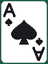 | 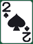 |  | 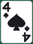 | 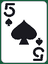 | 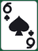 | 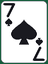 | 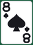 | 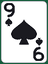 | 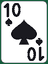 | 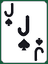 | 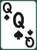 | 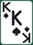 |
| **Hearts** |  | 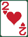 |  | 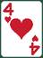 | 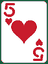 | 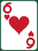 | 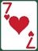 | 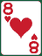 | 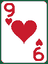 | 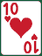 | 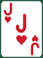 | 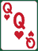 | 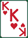 |
| **Diamonds** | 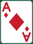 | 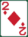 | 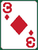 | 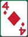 | 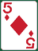 | 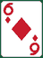 | 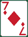 | 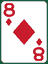 | 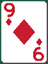 | 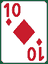 | 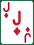 | 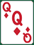 | 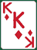 |
| **Clubs** | 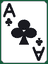 | 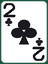 | 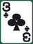 | 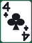 | 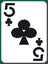 | 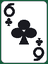 | 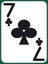 | 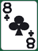 | 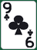 | 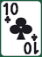 | 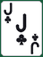 | 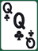 | 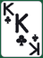 |

Back: 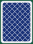

<!-- CARD_GALLERY:END -->

### ASL fingerspelling

<!-- SIGN_GALLERY:START -->

All 26 hands of the ASL manual alphabet. Each is cropped to its own drawing and fits a 64x84 box; J and Z are motions and their drawings carry the motion as an arrow.

|   |   |   |   |   |   |   |
|:-:|:-:|:-:|:-:|:-:|:-:|:-:|
| <br>**A** | <br>**B** | <br>**C** | <br>**D** | <br>**E** | <br>**F** | <br>**G** |
| <br>**H** | <br>**I** | <br>**J** | <br>**K** | <br>**L** | <br>**M** | <br>**N** |
| <br>**O** | <br>**P** | <br>**Q** | <br>**R** | <br>**S** | <br>**T** | <br>**U** |
| <br>**V** | <br>**W** | <br>**X** | <br>**Y** | <br>**Z** |   |   |

<!-- SIGN_GALLERY:END -->

---

## Credits

- Country flags — [lipis/flag-icons](https://github.com/lipis/flag-icons), MIT License.
- US state flags — [fonttools/region-flags](https://github.com/fonttools/region-flags),
  public domain (Wikipedia).
- US state outlines — [Natural Earth](https://www.naturalearthdata.com/), public domain.
- Playing cards — drawn by [`tools/render_cards.py`](tools/render_cards.py); no upstream artwork.
- ASL hands — WPClipart's "American ABCs" set, via
  [Wikimedia Commons](https://commons.wikimedia.org/wiki/File:Sign_language_A.svg), public domain (CC0).
