# map-n-flag

Country flags and map silhouettes for **195 countries** plus **51 US states**
(+ DC), baked into flash as plain C++ arrays for the ESP32. No runtime SVG
parsing, no SD card, no external asset loading — everything is `const` data in
`.rodata`.

Built for a 320×240 ESP32 "Cheap Yellow Display" (ILI9341, 4 MB flash, no PSRAM),
but there is nothing board-specific in the library.

- **Zero RAM.** `.bss` and `.data` are both 0 bytes — verified with `xtensa-esp32-elf-size`.
- **No LVGL required.** The core has no dependency beyond `stdint.h`. Draw with
  TFT_eSPI, LovyanGFX, or anything else. LVGL v8/v9 support is an optional header.
- **1.09 MiB** of flash for all 195 flags *and* 191 outlines.
- **280 KiB** more for 51 US state flags and outlines (opt-in, both commercially safe).

```cpp
#include "map_n_flag.h"

const mnf_img_t *flag = mnf_flag("FR");   // 80x60 indexed image
const mnf_img_t *map  = mnf_map("FR");    // silhouette, same ISO code
const char      *name = mnf_name("FR");   // "France"

// US states -- same image format, separate lookup
const mnf_img_t *sf = mnf_state_flag("CA");   // California flag
const mnf_img_t *sm = mnf_state_map("CA");    // California outline
const char      *sn = mnf_state_name("CA");   // "California"
```

---

## Install

### PlatformIO (recommended)

```ini
[env:app]
platform = espressif32
board = esp32dev
framework = arduino
board_build.partitions = huge_app.csv
lib_deps =
    bodmer/TFT_eSPI@^2.5.43
    https://github.com/iamankushpandit/map-n-flag.git
```

### Arduino IDE

Download the repo as a ZIP and use **Sketch → Include Library → Add .ZIP
Library**, or copy `src/` into your sketch folder.

### ⚠️ You must change the partition scheme

A 4 MB ESP32 on the Arduino **default** partition gives the app only **1.31 MB**
— less than this library alone. Use **"Huge APP (3MB No OTA/1MB SPIFFS)"**, or
in PlatformIO `board_build.partitions = huge_app.csv`.

---

## How to Use

This section walks you through the typical steps to get map-n-flag running on
your ESP32, from installation to drawing your first flag.

### 1. Install the library

Follow the [Install](#install) instructions above — PlatformIO is recommended.
Make sure you set the partition scheme to `huge_app.csv`.

### 2. Include the header and look up a country

```cpp
#include "map_n_flag.h"

// Lookup by ISO 3166-1 alpha-2 code (case-insensitive)
const mnf_img_t *flag = mnf_flag("DE");   // Germany flag (80×60)
const mnf_img_t *map  = mnf_map("DE");    // Germany outline silhouette
const char      *name = mnf_name("DE");   // "Germany"
```

All lookups return `NULL` for unknown codes, so always check the pointer before
drawing. Four countries (FM, MH, PS, TV) have a flag but no outline — use
`mnf_has_both()` to filter them when you need both.

### 3. Draw with TFT_eSPI (no LVGL)

Decode one row at a time straight from flash — no framebuffer, ~192 bytes of
scratch:

```cpp
#include <TFT_eSPI.h>
#include "map_n_flag.h"

TFT_eSPI tft;
static uint16_t row[96];

void draw_flag(const mnf_img_t *img, int16_t x, int16_t y) {
    if (img == NULL) return;
    tft.startWrite();
    for (uint16_t yy = 0; yy < img->h; yy++) {
        mnf_row_rgb565(img, yy, row, TFT_WHITE);
        tft.setAddrWindow(x, y + yy, img->w, 1);
        tft.pushPixels(row, img->w);
    }
    tft.endWrite();
}

void setup() {
    tft.init();
    tft.setRotation(1);
    tft.fillScreen(TFT_WHITE);
    draw_flag(mnf_flag("JP"), 30, 90);   // draw Japan's flag
}
```

Outline silhouettes store a 16-step alpha ramp — recolour them at draw time
with `mnf_row_rgb565_tint()`:

```cpp
// Draw Germany's outline in navy blue
for (uint16_t yy = 0; yy < map->h; yy++) {
    mnf_row_rgb565_tint(map, yy, row, TFT_WHITE,
                        tft.color565(0x1E, 0x3A, 0x8A));
    tft.setAddrWindow(200, 90 + yy, map->w, 1);
    tft.pushPixels(row, map->w);
}
```

See the complete sketch in [`examples/TftEspiDemo`](examples/TftEspiDemo/TftEspiDemo.ino).

### 4. Draw with LVGL (optional)

Include the optional adapter header. Each `mnf_lv_dsc_t` slot must stay alive
as long as the widget is visible — one slot per displayed image.

```cpp
#include "map_n_flag_lvgl.h"

static mnf_lv_dsc_t flag_slot;

lv_obj_t *img = lv_img_create(lv_scr_act());
lv_img_set_src(img, mnf_lv_bind(&flag_slot, mnf_flag("JP")));
lv_obj_center(img);
```

See the complete sketch in [`examples/LvglDemo`](examples/LvglDemo/LvglDemo.ino).

### 5. Iterate over all countries

```cpp
for (size_t i = 0; i < mnf_count(); i++) {
    const mnf_country_t *c = mnf_at(i);   // sorted by ISO code
    if (!mnf_has_both(c->iso2)) continue; // skip the 4 without an outline
    // use c->iso2, c->name, c->flag, c->map
}
```

### 6. Use US state assets (opt-in)

The state API mirrors the country API, keyed by 2-letter USPS abbreviation:

```cpp
const mnf_img_t *sf = mnf_state_flag("CA");   // California flag
const mnf_img_t *sm = mnf_state_map("CA");    // California outline
const char      *sn = mnf_state_name("CA");   // "California"
```

US state assets are commercially safe — see [Licensing](#licensing) for details.

---

## API

One header, thirteen functions, two structs. Lookup is a binary search over a
sorted table — no allocation, no init call, safe to use before any display setup.

```cpp
// --- lookup -------------------------------------------------------------
size_t               mnf_count(void);              // 195
const mnf_country_t *mnf_at(size_t index);         // sorted by ISO code
const mnf_country_t *mnf_find(const char *iso2);   // "FR" or "fr"
const mnf_img_t     *mnf_flag(const char *iso2);   // NULL if unknown
const mnf_img_t     *mnf_map(const char *iso2);    // NULL if unknown/absent
const char          *mnf_name(const char *iso2);   // "France"
bool                 mnf_has_both(const char *iso2);

// --- pixel access, for drawing without LVGL -----------------------------
uint8_t  mnf_index_at(const mnf_img_t *img, uint16_t x, uint16_t y);
uint32_t mnf_palette_argb(const mnf_img_t *img, uint8_t index);
uint32_t mnf_pixel_argb(const mnf_img_t *img, uint16_t x, uint16_t y);
uint16_t mnf_rgb565(uint8_t r, uint8_t g, uint8_t b);
void     mnf_row_rgb565(const mnf_img_t *img, uint16_t y, uint16_t *out, uint16_t bg565);
void     mnf_row_rgb565_tint(const mnf_img_t *img, uint16_t y, uint16_t *out,
                             uint16_t bg565, uint16_t fg565);
```

```cpp
typedef struct {
    uint16_t w;
    uint16_t h;
    const uint8_t *data;      // palette + 4bpp pixels
} mnf_img_t;

typedef struct {
    const char *iso2;         // "FR"
    const char *name;         // "France" (ASCII, no diacritics)
    const mnf_img_t *flag;    // NULL if not generated
    const mnf_img_t *map;     // NULL if not generated
} mnf_country_t;
```

Flags and outlines share the same ISO key, so pairing them for a "which flag
matches this outline?" mode is two calls with one string.

### US state API

The state API mirrors the country API, keyed by 2-letter USPS abbreviation.
All functions return `NULL`/`0`/`false` if `GENERATE_STATES` was off at build time.

```cpp
// --- US state lookup (parallel to country API) --------------------------
size_t               mnf_state_count(void);             // 51
const mnf_state_t   *mnf_state_at(size_t index);        // sorted by abbreviation
const mnf_state_t   *mnf_state_find(const char *st);    // "CA" or "ca"
const mnf_img_t     *mnf_state_flag(const char *st);    // NULL if unknown
const mnf_img_t     *mnf_state_map(const char *st);     // NULL if unknown/absent
const char          *mnf_state_name(const char *st);    // "California"
bool                 mnf_state_has_both(const char *st);
```

`mnf_state_t` is a typedef for `mnf_country_t` — same struct layout, so all
pixel access functions (`mnf_row_rgb565`, `mnf_row_rgb565_tint`, etc.) work
identically with state images.

### Drawing with TFT_eSPI (no LVGL)

Decode one row at a time straight from flash — no framebuffer, ~192 bytes of
scratch:

```cpp
static uint16_t row[96];

void draw_image(const mnf_img_t *img, int16_t x, int16_t y, uint16_t bg) {
    tft.startWrite();
    for (uint16_t yy = 0; yy < img->h; yy++) {
        mnf_row_rgb565(img, yy, row, bg);
        tft.setAddrWindow(x, y + yy, img->w, 1);
        tft.pushPixels(row, img->w);
    }
    tft.endWrite();
}

draw_image(mnf_flag("FR"), 30, 40, TFT_WHITE);
```

Outlines store a 16-step alpha ramp, so `mnf_row_rgb565_tint()` recolours them
at draw time without regenerating anything:

```cpp
mnf_row_rgb565_tint(img, yy, row, TFT_WHITE, tft.color565(0x1E, 0x3A, 0x8A));
```

Full sketch: [`examples/TftEspiDemo`](examples/TftEspiDemo/TftEspiDemo.ino).

### Drawing with LVGL (optional)

The bytes are already exactly what LVGL expects for a 4-bit indexed image, so
the adapter only fills in a descriptor — it copies no pixels and allocates
nothing. Works on v8 and v9.

```cpp
#include "map_n_flag_lvgl.h"

static mnf_lv_dsc_t flag_slot;    // must outlive the widget
lv_img_set_src(img, mnf_lv_bind(&flag_slot, mnf_flag("FR")));
```

Full sketch: [`examples/LvglDemo`](examples/LvglDemo/LvglDemo.ino).

### ⚠️ Stored size == displayed size (don't call `lv_img_set_zoom`)

Indexed images **cannot be scaled at runtime on LVGL v8**. Its decoder builds a
small palette in RAM and streams pixels from flash line by line — it never
populates `img_data`, and in `lv_draw_img.c` that line-by-line branch ignores
`zoom` and `angle` entirely. `lv_img_set_zoom()` **silently does nothing**.

That's the trade that makes these images cost 0 bytes of RAM. To show a bigger
flag, raise `FLAG_W`/`FLAG_H` and regenerate:

| Flag size | Per image | ×195 | On a 320×240 screen |
|---|---|---|---|
| 64×48 | 1,600 B | 305 KiB | small |
| **80×60** | **2,464 B** | **469 KiB** | **current — a quarter of screen width** |
| 112×84 | 4,768 B | 908 KiB | comfortable |
| 120×90 | 5,464 B | 1,040 KiB | prominent |
| 160×120 | 9,664 B | 1,840 KiB | half the screen |

If you draw with TFT_eSPI instead, you can scale however you like — the
constraint is LVGL's decoder, not the data.

---

## Flash footprint

Measured with `xtensa-esp32-elf-size` on compiled objects, not estimated.

### Countries

| | Count | Flash |
|---|---|---|
| Country flags @ 80×60 | 195 | 469.2 KiB |
| Country outlines @ ≤96 px | 191 | 642.7 KiB |
| **Country total** | **386** | **1,112 KiB (1.09 MiB)** |

### US states (opt-in)

| | Count | Flash |
|---|---|---|
| State flags @ 80×60 | 51 | 122.7 KiB |
| State outlines @ ≤96 px | 51 | 157.9 KiB |
| **State total** | **102** | **280.6 KiB (0.27 MiB)** |

| | Flash |
|---|---|
| Code (`.text`) | ~1.5 KiB |
| **RAM (`.bss` + `.data`)** | **0 bytes** |

Four countries have a flag but no outline — mapsicon omits them as too small to
draw: **FM, MH, PS, TV**. Their `map` pointer is `NULL`; use `mnf_has_both()`
to skip them in paired modes.

---

### ⚠️ Commercial use: turn the country outlines off

The **country** outline artwork (mapsicon) forbids resale, and **not using it is
not enough** — the generated `mnf_table.cpp` references every outline, so the
data stays linked into any firmware that includes this library. To ship
something you sell:

```python
# tools/config.py
GENERATE_MAPS = False
```

That emits no outline arrays, NULLs every `map` pointer, and drops the build
from 1.11 MiB to **469 KiB** — leaving only the MIT-licensed flags. `mnf_map()`
then returns `NULL` for every country, so guard with `mnf_has_both()` or check
the pointer.

**US state assets are commercially safe.** State flags come from
fonttools/region-flags (public domain) and state outlines from Natural Earth
(public domain). `GENERATE_STATES = True` is fine in commercial firmware.

---

## Regenerating

The library is generated by an offline pipeline. You only need this if you want
a different resolution or country set.

```bash
pip install -r requirements.txt
npm install
python tools/fetch_sources.py     # shallow-clones the artwork repos
python tools/build.py             # regenerates src/
python tools/verify.py            # decodes it all back and renders a check sheet
python tools/export_previews.py   # rebuilds the gallery below
```

Rasterisation uses `sharp`, whose prebuilt Windows binary bundles librsvg, so
there is no Cairo/GTK install to fight with.

Size a change before committing to it:

```bash
python tools/build.py --report --scope curated
```

### Tuning

Everything adjustable lives in [`tools/config.py`](tools/config.py):

| Setting | Default | Effect |
|---|---|---|
| `SCOPE` | `"un195"` | `"all"` (~249), `"un195"` (195), `"curated"` (~62) |
| `FLAG_W` / `FLAG_H` | `80` / `60` | Flag resolution |
| `MAP_BOX` | `96` | Max outline dimension |
| `MAP_INK` | navy | Baked silhouette colour (overridable at draw time) |
| `TU_SPLIT` | `4` | Number of generated `.cpp` files |
| `GENERATE_STATES` | `True` | Include US state flags and maps |
| `GENERATE_STATE_MAPS` | `True` | Include state outline maps |

| Scope | Countries | Flags | Maps | Total |
|---|---|---|---|---|
| `all` | 249 | 599.2 KiB | 804.8 KiB | 1.37 MiB |
| `un195` | 195 | 469.2 KiB | 642.7 KiB | **1.09 MiB** ← current |
| `curated` | 62 | 149.2 KiB | 200.6 KiB | 0.34 MiB |

US states add ~280 KiB (122.7 KiB flags + 157.9 KiB maps). Set
`GENERATE_STATES = False` to exclude them entirely.

---

## Design notes

**Image format.** Every image is 4-bit indexed:

```
[16 palette entries × 4 bytes: B, G, R, A][4bpp pixel rows]
```

Rows are padded to whole bytes (`stride = (w + 1) / 2`), and the **leftmost
pixel of each pair is the high nibble**. That is byte-for-byte what LVGL v8 and
v9 both expect — verified against `lv_img_buf.c` and `lv_bin_decoder.c`, where
both compute `shift = 4 - 4 * (x & 1)`.

**Why 80×60 flags.** Measured, not guessed. At 64×48 the US stripes alias into
moiré; at 80×60 they resolve cleanly and India's chakra and Korea's trigrams
survive. 96×72 costs 43% more flash and buys almost nothing, because the
emblem-heavy flags (Mexico, Portugal, Ecuador) are illegible at every size in
this range — and you identify those by colour layout anyway.

**Why 16 colours is enough.** Flags are flat colour blocks. Across all 249,
quantising to a per-flag 16-entry palette gives a mean RGB error of **1.4 out of
a possible 441**. A per-image palette costs 64 bytes and beats any shared one.

**Why indexed and not RGB565.** 4 bpp instead of 16 is ~4× smaller. It also
sidesteps the RGB565 byte-swap problem that bites CYD users, since the palette
is stored as 32-bit ARGB regardless of display endianness.

**Why outlines are indexed too, not `A4`.** A 4-bit alpha mask is the obvious
choice, but LVGL v9 lists `A1`/`A2`/`A4` under *"formats not supported by
software renderer"* — they are GPU-only, and the CYD has no GPU. An `A4` map
would render on v8 and silently break on v9. So outlines use `I4` with a
palette that is a 16-step alpha ramp of one colour: same 4 bpp, plus 64 bytes,
and it renders everywhere. It also makes runtime recolouring trivial.

**Non-rectangular flags.** Nepal's flag is a double pennant. Rather than
flatten it onto a white box, palette slot 0 is reserved as fully transparent
whenever a flag has transparent pixels, so it composites over any background.

**Outline cropping.** Each silhouette is cropped to its tight bounding box
before scaling to fit `MAP_BOX`. Chile becomes ~17×96 instead of a mostly-empty
96×96. Read `img->w` / `img->h` for real dimensions; `MNF_MAP_BOX` is only the
maximum.

Note that mapsicon normalises **each country to fill its own frame**, so the
silhouettes carry no relative-size information — Vatican City and Russia are
drawn at the same scale. That is the right call for recognisability at 96 px,
but don't build a "which country is bigger?" mode on this data.

---

## Licensing

The **pipeline and library code** in this repo are MIT (see `LICENSE`).
The **artwork** comes from two upstream projects:

| Asset set | Source | License | Commercial? |
|---|---|---|---|
| Country flags | [lipis/flag-icons](https://github.com/lipis/flag-icons) | **MIT** | ✅ Yes |
| Country outlines | [djaiss/mapsicon](https://github.com/djaiss/mapsicon) | ⚠️ **Custom** | ❌ No resale |
| US state flags | [fonttools/region-flags](https://github.com/fonttools/region-flags) | **Public domain** | ✅ Yes |
| US state outlines | [Natural Earth](https://www.naturalearthdata.com/) | **Public domain** | ✅ Yes |

mapsicon (country outlines) has no standard license. Its README states, verbatim:

> Do what you want with them as long as you mention me in your project.
> Please don't resell them - I forbid it!

**Fine for a personal or hobby project, provided you credit David Jaiss** — the
credit is in every generated file, in `NOTICE.md`, and here. Please also put it
on an about/credits screen.

**It is not usable in anything you sell.** If this ever becomes commercial, the
outline artwork must be replaced. The drop-in replacement is
[Natural Earth](https://www.naturalearthdata.com/) `admin_0_countries` (public
domain), which touches only `load_map()` in `tools/build.py`. The flags are MIT
and need no changes either way.

**US state assets are commercially safe.** Both the state flags (public domain
from Wikipedia) and state outlines (Natural Earth, public domain) can be used
in commercial products without restriction.

---

## Gallery

<!-- GALLERY:START -->

All 195 countries in the current build (`SCOPE = "un195"`). Flags are 80x60; outlines are cropped to their own bounding box and shown centred in a 96x96 square. These PNGs are decoded from the generated C arrays, so they are exactly what the device draws.

| Code | Country | Flag | Outline |
|:----:|:--------|:----:|:-------:|
| **AD** | Andorra | 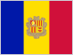 | — |
| **AE** | United Arab Emirates |  | — |
| **AF** | Afghanistan |  | — |
| **AG** | Antigua and Barbuda | 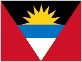 | — |
| **AL** | Albania | 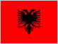 | — |
| **AM** | Armenia | 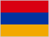 | — |
| **AO** | Angola | 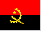 | — |
| **AR** | Argentina | 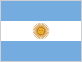 | — |
| **AT** | Austria |  | — |
| **AU** | Australia |  | — |
| **AZ** | Azerbaijan |  | — |
| **BA** | Bosnia and Herzegovina | 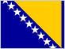 | — |
| **BB** | Barbados |  | — |
| **BD** | Bangladesh |  | — |
| **BE** | Belgium |  | — |
| **BF** | Burkina Faso | 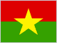 | — |
| **BG** | Bulgaria | 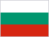 | — |
| **BH** | Bahrain |  | — |
| **BI** | Burundi | 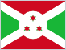 | — |
| **BJ** | Benin | 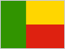 | — |
| **BN** | Brunei | 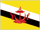 | — |
| **BO** | Bolivia | 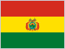 | — |
| **BR** | Brazil | 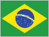 | — |
| **BS** | Bahamas | 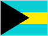 | — |
| **BT** | Bhutan |  | — |
| **BW** | Botswana | 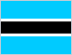 | — |
| **BY** | Belarus | 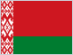 | — |
| **BZ** | Belize |  | — |
| **CA** | Canada |  | — |
| **CD** | DR Congo | 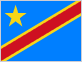 | — |
| **CF** | Central African Republic | 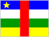 | — |
| **CG** | Congo | 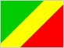 | — |
| **CH** | Switzerland |  | — |
| **CI** | Ivory Coast | 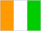 | — |
| **CL** | Chile |  | — |
| **CM** | Cameroon |  | — |
| **CN** | China |  | — |
| **CO** | Colombia | 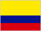 | — |
| **CR** | Costa Rica | 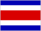 | — |
| **CU** | Cuba |  | — |
| **CV** | Cape Verde | 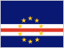 | — |
| **CY** | Cyprus | 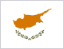 | — |
| **CZ** | Czechia |  | — |
| **DE** | Germany |  | — |
| **DJ** | Djibouti | 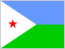 | — |
| **DK** | Denmark | 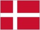 | — |
| **DM** | Dominica | 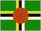 | — |
| **DO** | Dominican Republic | 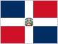 | — |
| **DZ** | Algeria | 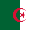 | — |
| **EC** | Ecuador | 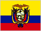 | — |
| **EE** | Estonia |  | — |
| **EG** | Egypt |  | — |
| **ER** | Eritrea | 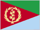 | — |
| **ES** | Spain | 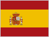 | — |
| **ET** | Ethiopia |  | — |
| **FI** | Finland |  | — |
| **FJ** | Fiji | 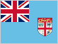 | — |
| **FM** | Micronesia |  | — |
| **FR** | France | 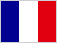 | — |
| **GA** | Gabon |  | — |
| **GB** | United Kingdom |  | — |
| **GD** | Grenada | 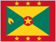 | — |
| **GE** | Georgia | 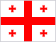 | — |
| **GH** | Ghana |  | — |
| **GM** | Gambia | 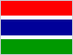 | — |
| **GN** | Guinea | 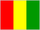 | — |
| **GQ** | Equatorial Guinea |  | — |
| **GR** | Greece |  | — |
| **GT** | Guatemala | 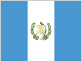 | — |
| **GW** | Guinea-Bissau | 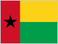 | — |
| **GY** | Guyana | 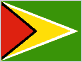 | — |
| **HN** | Honduras | 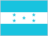 | — |
| **HR** | Croatia |  | — |
| **HT** | Haiti | 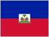 | — |
| **HU** | Hungary | 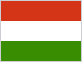 | — |
| **ID** | Indonesia | 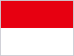 | — |
| **IE** | Ireland | 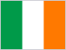 | — |
| **IL** | Israel |  | — |
| **IN** | India |  | — |
| **IQ** | Iraq |  | — |
| **IR** | Iran |  | — |
| **IS** | Iceland | 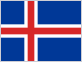 | — |
| **IT** | Italy |  | — |
| **JM** | Jamaica | 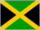 | — |
| **JO** | Jordan |  | — |
| **JP** | Japan |  | — |
| **KE** | Kenya | 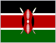 | — |
| **KG** | Kyrgyzstan |  | — |
| **KH** | Cambodia |  | — |
| **KI** | Kiribati |  | — |
| **KM** | Comoros |  | — |
| **KN** | Saint Kitts and Nevis |  | — |
| **KP** | North Korea |  | — |
| **KR** | South Korea |  | — |
| **KW** | Kuwait |  | — |
| **KZ** | Kazakhstan |  | — |
| **LA** | Laos |  | — |
| **LB** | Lebanon |  | — |
| **LC** | Saint Lucia |  | — |
| **LI** | Liechtenstein |  | — |
| **LK** | Sri Lanka |  | — |
| **LR** | Liberia |  | — |
| **LS** | Lesotho |  | — |
| **LT** | Lithuania |  | — |
| **LU** | Luxembourg |  | — |
| **LV** | Latvia |  | — |
| **LY** | Libya |  | — |
| **MA** | Morocco |  | — |
| **MC** | Monaco |  | — |
| **MD** | Moldova |  | — |
| **ME** | Montenegro |  | — |
| **MG** | Madagascar |  | — |
| **MH** | Marshall Islands |  | — |
| **MK** | North Macedonia |  | — |
| **ML** | Mali |  | — |
| **MM** | Myanmar |  | — |
| **MN** | Mongolia |  | — |
| **MR** | Mauritania |  | — |
| **MT** | Malta |  | — |
| **MU** | Mauritius |  | — |
| **MV** | Maldives |  | — |
| **MW** | Malawi |  | — |
| **MX** | Mexico |  | — |
| **MY** | Malaysia |  | — |
| **MZ** | Mozambique |  | — |
| **NA** | Namibia |  | — |
| **NE** | Niger |  | — |
| **NG** | Nigeria |  | — |
| **NI** | Nicaragua |  | — |
| **NL** | Netherlands |  | — |
| **NO** | Norway |  | — |
| **NP** | Nepal |  | — |
| **NR** | Nauru |  | — |
| **NZ** | New Zealand |  | — |
| **OM** | Oman |  | — |
| **PA** | Panama |  | — |
| **PE** | Peru |  | — |
| **PG** | Papua New Guinea |  | — |
| **PH** | Philippines |  | — |
| **PK** | Pakistan |  | — |
| **PL** | Poland |  | — |
| **PS** | Palestine |  | — |
| **PT** | Portugal |  | — |
| **PW** | Palau |  | — |
| **PY** | Paraguay |  | — |
| **QA** | Qatar |  | — |
| **RO** | Romania |  | — |
| **RS** | Serbia |  | — |
| **RU** | Russia |  | — |
| **RW** | Rwanda |  | — |
| **SA** | Saudi Arabia |  | — |
| **SB** | Solomon Islands |  | — |
| **SC** | Seychelles |  | — |
| **SD** | Sudan |  | — |
| **SE** | Sweden |  | — |
| **SG** | Singapore |  | — |
| **SI** | Slovenia |  | — |
| **SK** | Slovakia |  | — |
| **SL** | Sierra Leone |  | — |
| **SM** | San Marino |  | — |
| **SN** | Senegal |  | — |
| **SO** | Somalia |  | — |
| **SR** | Suriname |  | — |
| **SS** | South Sudan |  | — |
| **ST** | Sao Tome and Principe |  | — |
| **SV** | El Salvador |  | — |
| **SY** | Syria |  | — |
| **SZ** | Eswatini |  | — |
| **TD** | Chad |  | — |
| **TG** | Togo |  | — |
| **TH** | Thailand |  | — |
| **TJ** | Tajikistan |  | — |
| **TL** | East Timor |  | — |
| **TM** | Turkmenistan |  | — |
| **TN** | Tunisia |  | — |
| **TO** | Tonga |  | — |
| **TR** | Turkey |  | — |
| **TT** | Trinidad and Tobago |  | — |
| **TV** | Tuvalu |  | — |
| **TZ** | Tanzania |  | — |
| **UA** | Ukraine |  | — |
| **UG** | Uganda |  | — |
| **US** | United States |  | — |
| **UY** | Uruguay |  | — |
| **UZ** | Uzbekistan |  | — |
| **VA** | Vatican City |  | — |
| **VC** | Saint Vincent and the Grenadines |  | — |
| **VE** | Venezuela |  | — |
| **VN** | Vietnam |  | — |
| **VU** | Vanuatu |  | — |
| **WS** | Samoa |  | — |
| **YE** | Yemen |  | — |
| **ZA** | South Africa |  | — |
| **ZM** | Zambia |  | — |
| **ZW** | Zimbabwe |  | — |

<!-- GALLERY:END -->

### US States

<!-- STATE_GALLERY:START -->

All 51 US states (+ DC). Same format as above.

| Code | State | Flag | Outline |
|:----:|:------|:----:|:-------:|
| **AK** | Alaska |  |  |
| **AL** | Alabama |  |  |
| **AR** | Arkansas |  |  |
| **AZ** | Arizona |  |  |
| **CA** | California |  |  |
| **CO** | Colorado |  |  |
| **CT** | Connecticut |  |  |
| **DC** | District of Columbia |  |  |
| **DE** | Delaware |  |  |
| **FL** | Florida |  |  |
| **GA** | Georgia |  |  |
| **HI** | Hawaii |  |  |
| **IA** | Iowa |  |  |
| **ID** | Idaho |  |  |
| **IL** | Illinois |  |  |
| **IN** | Indiana |  |  |
| **KS** | Kansas |  |  |
| **KY** | Kentucky |  |  |
| **LA** | Louisiana |  |  |
| **MA** | Massachusetts |  |  |
| **MD** | Maryland |  |  |
| **ME** | Maine |  |  |
| **MI** | Michigan |  |  |
| **MN** | Minnesota |  |  |
| **MO** | Missouri |  |  |
| **MS** | Mississippi |  |  |
| **MT** | Montana |  |  |
| **NC** | North Carolina |  |  |
| **ND** | North Dakota |  |  |
| **NE** | Nebraska |  |  |
| **NH** | New Hampshire |  |  |
| **NJ** | New Jersey |  |  |
| **NM** | New Mexico |  |  |
| **NV** | Nevada |  |  |
| **NY** | New York |  |  |
| **OH** | Ohio |  |  |
| **OK** | Oklahoma |  |  |
| **OR** | Oregon |  |  |
| **PA** | Pennsylvania |  |  |
| **RI** | Rhode Island |  |  |
| **SC** | South Carolina |  |  |
| **SD** | South Dakota |  |  |
| **TN** | Tennessee |  |  |
| **TX** | Texas |  |  |
| **UT** | Utah |  |  |
| **VA** | Virginia |  |  |
| **VT** | Vermont |  |  |
| **WA** | Washington |  |  |
| **WI** | Wisconsin |  |  |
| **WV** | West Virginia |  |  |
| **WY** | Wyoming |  |  |

<!-- STATE_GALLERY:END -->

---

## Credits

- Country flags — [lipis/flag-icons](https://github.com/lipis/flag-icons), MIT License.
- Country outlines — [djaiss/mapsicon](https://github.com/djaiss/mapsicon) by **David Jaiss**,
  used with attribution. Not licensed for resale.
- US state flags — [fonttools/region-flags](https://github.com/fonttools/region-flags),
  public domain (Wikipedia).
- US state outlines — [Natural Earth](https://www.naturalearthdata.com/), public domain.
